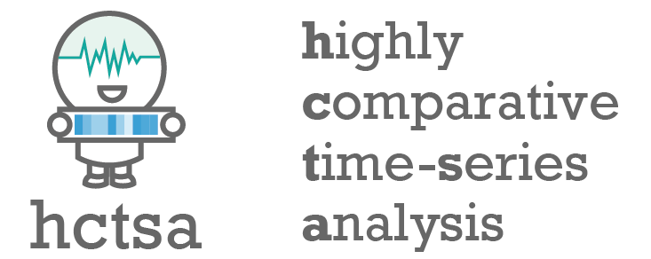

# Introduction

<figure><figcaption></figcaption></figure>

This documentation contains resources and information about highly comparative time-series analysis using _hctsa_, and also outlines the steps required to **set up and implement highly comparative time-series analysis** using the [_hctsa_ package](https://github.com/benfulcher/hctsa), as described in our papers:

1. B.D. Fulcher and N.S. Jones. [_hctsa_: A computational framework for automated time-series phenotyping using massive feature extraction](https://doi.org/10.1016/j.cels.2017.10.001). _Cell Systems_ **5**, 527 (2017).
2. B.D. Fulcher, M.A. Little, N.S. Jones. [Highly comparative time-series analysis: the empirical structure of time series and their methods](https://doi.org/10.1098/rsif.2013.0048). _J. Roy. Soc. Interface_ **10**, 20130048 (2013).

This manual documents _hctsa_ v3.0.0, which computes 6392 features from 927 master operations and requires Matlab R2022a or later.
Future development is planned to happen in the Python package [_pyhctsa_](https://github.com/DynamicsAndNeuralSystems/pyhctsa).
