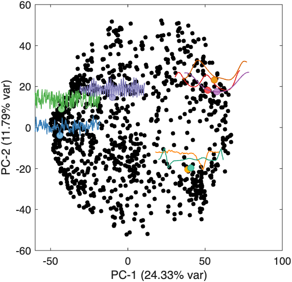

# Low dimensional representation

The software also provides a basic means of visualizing low-dimensional representations of the data, using PCA as `TS_PlotLowDim`.
A t-SNE projection can be used instead by specifying `'tSNE'` in place of `'pca'`.

This can be done for a time-series dataset as follows:

```
TS_PlotLowDim('norm','pca');
```

This uses the normalized data (specifying `'norm'`), plotting time series in the reduced, two-dimensional principal components space of operations (the leading two principal components of the data matrix).

By default, 6 randomly chosen points are annotated with their corresponding time series (the first 300 samples of each) and their names, without user input.
To choose the points to annotate yourself, pass `annotateParams` (the fourth input) as a structure: for example, `TS_PlotLowDim('norm','pca',true,struct('n',10,'textAnnotation','Name'))` prompts you to click on 10 points on the plot (`userInput` is `true` by default when `annotateParams` is a structure).
Passing an integer annotates that many randomly chosen points, and `0` (or `false`) turns annotation off.

After selecting 10 points, we have the following:


The proportion of variance explained by each principal component is provided in parentheses in the axis label.

## Customizing annotations

Annotation properties can be altered with some detail by specifying properties as the `annotateParams` input variable, for example:

```
% Set whether to plot marginal distributions:
showDistributions = false;
% Set up the annotateParams structure:
annotateParams = struct;
annotateParams.n = 8; % annotate 8 time series
annotateParams.maxL = 150; % annotates the first 150 samples of time series
annotateParams.userInput = false; % points not selected by user but allocated randomly
annotateParams.textAnnotation = 'none'; % don't display names of annotated time series ('Name', 'ID', or 'length' to display them)

% Generate a plot using these settings:
TS_PlotLowDim('norm','pca',showDistributions,annotateParams);
```

which yields:



Other fields of `annotateParams` include `fdim` (the width and height of each annotation, as fractions of the plot size), `theLineWidth`, `doRainbow`, and `cmap` (cf. `BF_AnnotatePoints`).

## Plotting grouped time series

If groups of time series have been specified (using `TS_LabelGroups`), then these are automatically recognized by `TS_PlotLowDim`, which will then distinguish the labeled groups in the resulting 2-dimensional annotated time-series plot.

Consider the sample dataset containing 20 periodic signals with additive noise (given the keyword **noisy**), and 20 purely periodic signals (given the keyword **periodic**). After retrieving and normalizing the data, we store the two groups in the metadata for the normalized dataset **HCTSA\_N.mat**:

```
TS_LabelGroups('norm',{'noisy','periodic'},true);
```

The function reports how many of the 40 time series match each keyword (20 for each), and saves the group labels back to `HCTSA_N.mat`.

Now when we plot the dataset in `TS_PlotLowDim`, it will automatically distinguish the groups in the plot and attempt to classify the difference in the reduced principal components space.

Running the following:

```
annotateParams = struct('n',6); % annotate 6 time series
showDistributions = true; % plot marginal distributions
TS_PlotLowDim('norm','pca',showDistributions,annotateParams);
```

The function then directs you to select 6 points to annotate time series to, producing the following:


Notice how the two labeled groups have been distinguished as red and blue points, and a linear classification boundary has been added (boundaries are drawn when there are fewer than five classes).
The in-sample classification accuracy (balanced accuracy if the classes are unbalanced) is annotated to the title (for both components combined) and to each principal-component axis label.
If marginal distributions are plotted (setting `showDistributions = true` above), they are labeled according to the same colors.
