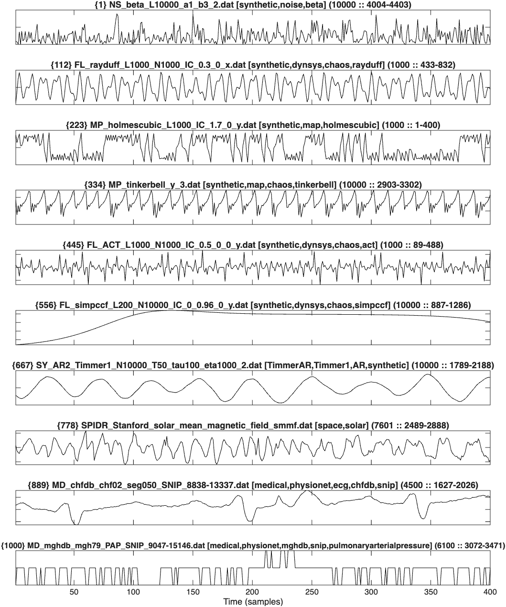
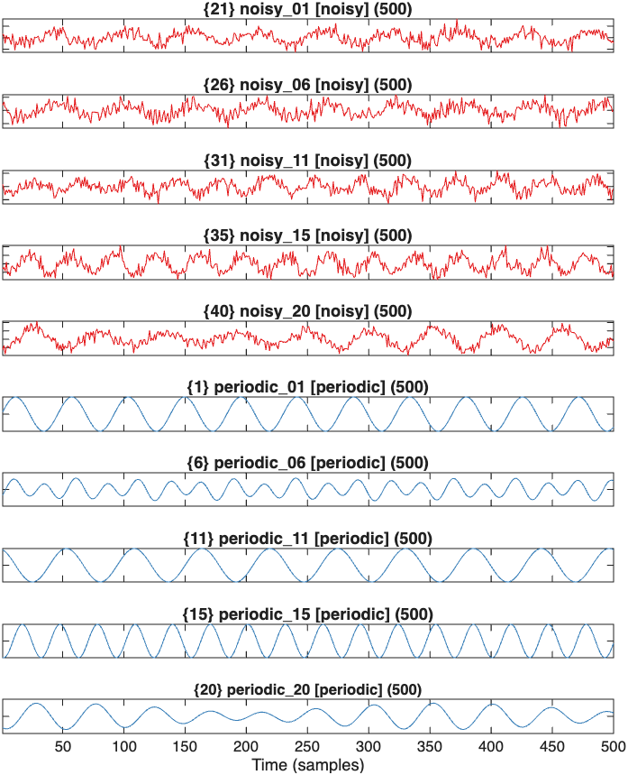

# Plotting the time series

The _hctsa_ package provides a simple means of plotting time series: the `TS_PlotTimeSeries` function.
Its inputs are `TS_PlotTimeSeries(whatData,numPerGroup,whatTimeSeries,maxLength,plotOptions)`.
The time series to plot, `whatTimeSeries`, can be `'all'`, the name of a group (in `TimeSeries.Group`), a keyword, a vector of indices, or `'grouped'` (or empty) to plot examples of each labeled group.

## Basic plotting

For example, to plot a set of time series that have not been assigned groups, we can run the following:

```
    whatData = 'norm'; % Get data from HCTSA_N.mat
    plotWhatTimeSeries = 'all'; % plot examples from all time series
    plotHowMany = 10; % how many to plot
    maxLength = 400; % maximum number of samples to plot for each time series
    plotOptions = struct('plotFreeForm',false); % plot each time series in its own subplot
    TS_PlotTimeSeries(whatData,plotHowMany,plotWhatTimeSeries,maxLength,plotOptions);
```

For our assorted set of time series, this produces the following:



Showing 400 samples of 10 selected time series, equally-spaced through the TimeSeries IDs in `HCTSA_N.mat`.
In this subplot layout, a time series longer than `maxLength` is shown as a randomly positioned segment of `maxLength` samples (its range is given in the title).

## Freeform plotting

Many more custom plotting options are available by passing an options structure to `TS_PlotTimeSeries`, including the `'plotFreeForm'` option.
Free-form plotting (the default, `plotFreeForm = true`) shows all time series in a single set of axes, which allows very many time series to be shown in one plot:

```
    % Plot as a freeform plot without labeling time series:
    plotOptions = struct('plotFreeForm',true,'displayTitles',false);
    TS_PlotTimeSeries('norm',40,'all',300,plotOptions);
```


producing an overview picture of the first 300 samples of 40 time series (spaced through the rows of the data matrix).

Other fields of `plotOptions` (with their defaults) are: `displayTitles` (`true`), `howToFilter` (how to choose the time series to plot: `'evenly'`, `'firstcome'`, or `'rand'`; default `'evenly'`), `colorMap`, `LineWidth` (1), `newFigure` (`true`), `sortByLength` (`false`), and `carpetPlot` (`false`; plots the time series as a grayscale image).

## Dealing with groups of time series

When the time series have been assigned groups (using `TS_LabelGroups`, [here](grouping.md)), this information is automatically incorporated into `TS_PlotTimeSeries`, which then plots a given number of each time series group, and colors them accordingly:

```
    numPerGroup = 5; % plot this many examples of each group of time series
    plotHow = 'grouped'; % plot examples of each assigned group of time series
    plotOptions = struct('plotFreeForm',false); % plot each time series in its own subplot
    TS_PlotTimeSeries('norm',numPerGroup,plotHow,500,plotOptions);
```



In this case the two labeled groups of time series are recognized by the function: red (noisy), blue (no noise), and then 5 time series in each group are plotted, showing a 500-sample segment of each time series.
