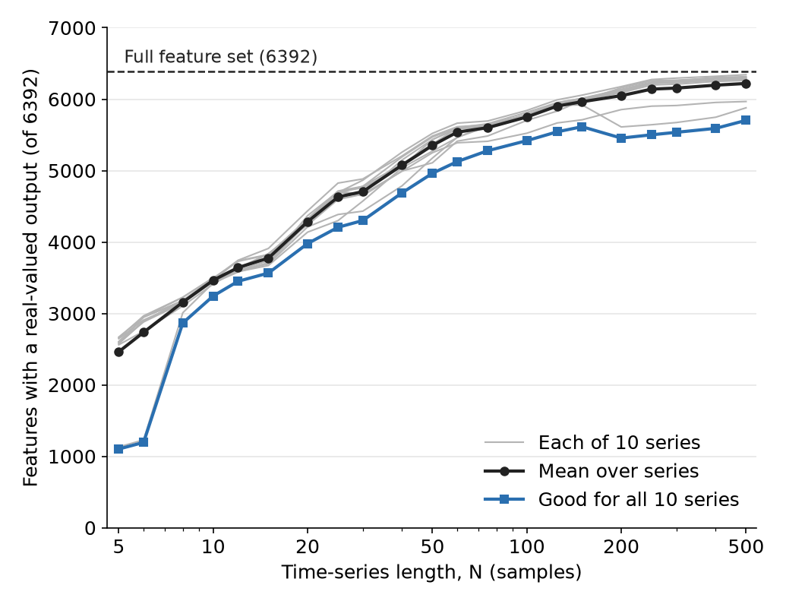
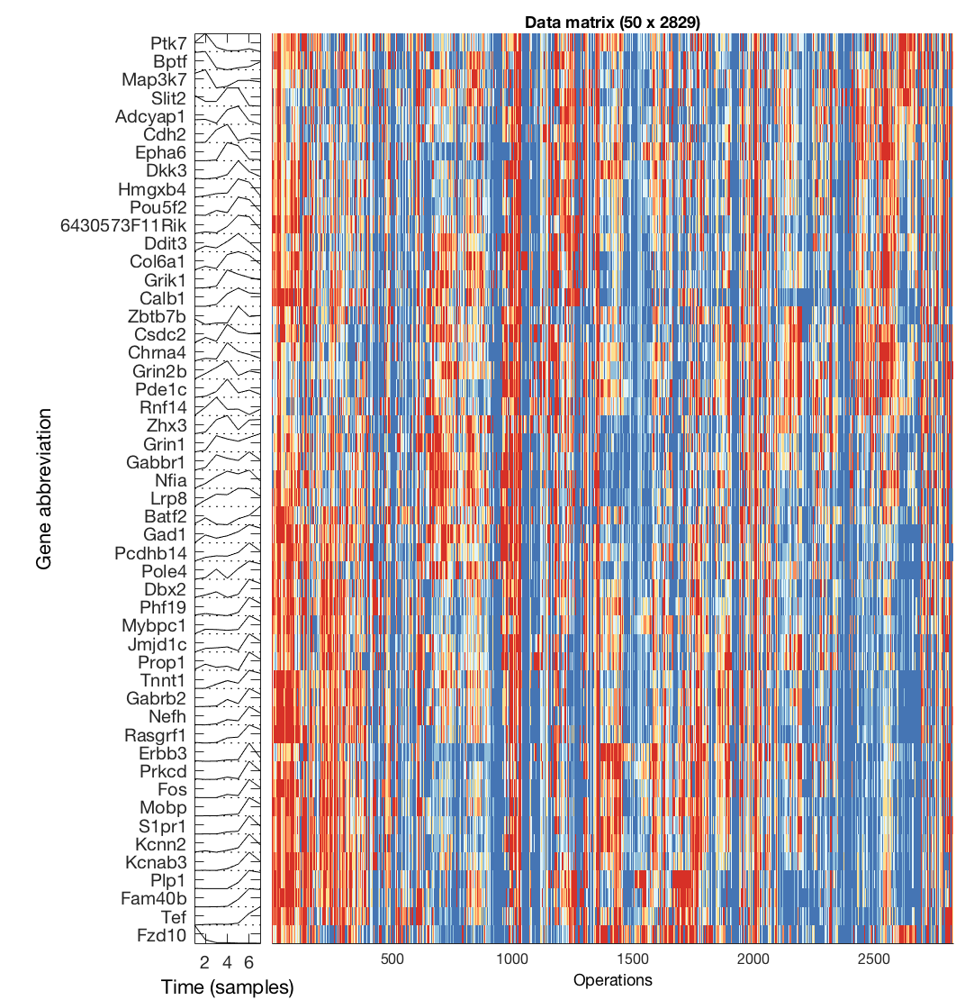

# Working with short time series

Although many sections of the time-series analysis literature has worked to develop methods for quantifying complex temporal structure in long time-series recordings, many time series that are analyzed in practice are relatively short. _hctsa_ has been successfully applied to time-series classification problems in the data mining literature, which includes datasets of time series as short as 60 samples ([link to paper](http://ieeexplore.ieee.org/lpdocs/epic03/wrapper.htm?arnumber=6786425)). However, time-series data are sometimes even shorter, including yearly economic data across perhaps six years, or biological data measured at say 10 points across a lifespan. Although many features in _hctsa_ will not give a meaningful output when applied to a short time series, _hctsa_ includes methods for filtering such features (cf. [`TS_Normalize`](filtering\_and\_normalizing.md)), after which the remaining features can be used for analysis.

The number of features with a meaningful output, from time series as short as 5 samples, up to those with as many as 500 samples, is shown below (where the maximum set, 7749 features in the older version of _hctsa_ this plot was generated from, is shown as a dashed horizontal line; the default set in _hctsa_ v3.0.0 has 6392 features): 

In each case, over 3000 features could be computed with that version (the counts for v3.0.0 will differ, as many features have since been redefined, added or removed).
Note that one must be careful when representing a 5-dimensional object with thousands of features, the vast majority of which will be highly intercorrelated.

When computing features for a large number of short time series, `TS_Compute('series')` parallelizes the computation over time series, which is much faster than parallelizing over the operations within each time series (`TS_Compute('operations')`; see [Running computations](../calculating/running\_computations.md)).

## Example application to developmental gene-expression data

To demonstrate the feasibility of running _hctsa_ analysis on datasets of short time series, we applied _hctsa_ to gene expression data in the cerebellar brain region, r1A, across seven developmental time points (from the Allen Institute's [Developing Mouse Brain Atlas](http://developingmouse.brain-map.org)), for a subset of 50 genes.
After filtering and normalizing (`TS_Normalize`), then clustering (`TS_Cluster`), we plotted the clustered time-series data matrix (`TS_PlotDataMatrix`, which uses the clustered ordering when it exists):

Inspecting the time series plots to the left of the colored matrix, we can see that genes with similar temporal expression profiles are clustered together based on their 2829-long feature vector representations (the number of features retained after filtering, with the version of _hctsa_ used for this analysis).
Thus, these feature-based representations provide a meaningful representation of these short time series.
Further, while these 2829-long feature vectors are shorter than those that can be computed from longer time series, they still constitute a highly comprehensive representation that can be used as the starting point to obtain interpretable understanding in addressing specific domain questions.
