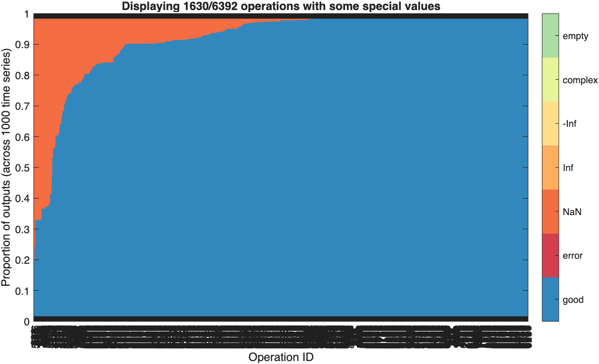

# Inspecting errors

When applying thousands of time-series analysis methods to diverse datasets, many operations can give results that are not real numbers. Some time series may be inappropriate for a given operation (such as fitting a positive-only distribution to data that is not positive), or measuring stationarity across 2000 datapoints in time series that are shorter than 2000 samples. Other times, an optimization routine may fail, or some unknown error may be called.

Some errors are not problems with the code, but represent issues with applying particular sets of code to particular time series, such as when a Matlab fitting function reaches the maximum number of iterations and returns an error. Other errors are genuine problems with the code that need to be corrected. Both cases are labeled as errors in our framework.

It can be good practice to visualize where special values and errors are occurring after a computation to see where things might be going wrong, using `TS_InspectQuality`. This can be run in four modes:

1. `TS_InspectQuality('summary');` \[default] Summarizes the proportion of special-valued outputs in each operation as a bar plot, ordered by the proportion of special-valued outputs.
2. `TS_InspectQuality('master');` Plots which types of special-valued outputs were encountered for each master operation.
3. `TS_InspectQuality('full');` Plots the full data matrix (all time series as rows and all operations as columns), and shows where each possible special-valued output can occur (including 'error', 'NaN', 'Inf', '-Inf', 'complex', 'empty', or a 'link error').
4. `TS_InspectQuality('reduced');` As `'full'`, but includes only columns where special values occurred.

The full set of inputs is `hadProblem = TS_InspectQuality(inspectWhat,customFile,askIfLarge)`, where `customFile` is the _hctsa_ file to inspect (`HCTSA.mat` by default; shorthands like `'raw'` and `'norm'` also work), and `askIfLarge` (default `true`) waits for a key press before plotting a very large matrix (more than 900,000 entries) in the `'full'` and `'reduced'` modes (set it to `false` to plot without waiting).
In the `'full'` and `'reduced'` plots, entries that have not yet been calculated are shown as a separate '(uncalculated)' category.
The codes stored in `TS_Quality` for each type of output are listed [here](../setup/hctsa\_structure.md#quality-labels).

For example, for the 1000 time series of the [Empirical1000](https://doi.org/10.6084/m9.figshare.5436136) dataset, running `TS_InspectQuality('summary')` loads in data from **HCTSA.mat** and produces the following, which can be zoomed in on and explored to understand which features are producing problematic outputs:



Here 1630 of the 6392 operations produced a special value for at least one time series.
Almost all of these special values are NaN (131,509 outputs, compared to 147 Inf, 21 -Inf, and 3 empty outputs, which are too few to see at this scale), and there were no errors.
In `'summary'` mode, each of these operations is also listed in the command window, from the highest proportion of special values to the lowest:

```
1630 operations have special values:
[300] CO_AutoCorrShape_posDrown_meanmaxima (CO_AutoCorrShape_posDrown.meanmaxima) -- 80.6% special values.
[299] CO_AutoCorrShape_posDrown_meanminima (CO_AutoCorrShape_posDrown.meanminima) -- 80.2% special values.
[5686] SP_Summaries_welch_rect_meanProm_5 (SP_Summaries_welch_rect.meanProm_5) -- 75.7% special values.
[5687] SP_Summaries_welch_rect_meanPeakWidth_prom5 (SP_Summaries_welch_rect.meanPeakWidth_prom5) -- 75.7% special values.
[953] DN_CompareKSFit_gamma_adiff (DN_CompareKSFit_gamma.adiff) -- 67.0% special values.
...
```

## Errors with compiled code

Note that errors returned from Matlab files do not halt the progress of the computation (using `try-catch` statements), but errors with compiled **mex** functions (or external command-line packages like TISEAN) can produce a fault that crashes Matlab or the system. We have performed some basic testing on all mex functions, but for some unusual time series, such faults may still occur. These situations must be dealt with by either identifying and fixing the problem in the original source code and recompiling, or by removing the problem code.

If you computed TISEAN-based features in parallel on Linux with a version of _hctsa_ earlier than v3.0.0, recompute them: under load, program output could be truncated, giving errors or wrong values.

## Troubleshooting errors

When getting information on operations that produce special-valued outputs (getting IDs listed from `TS_InspectQuality`), it can be useful to then test examples by re-running pieces of code with the problematic data.
The function `TS_WhichProblemTS` can be used to retrieve time series from an _hctsa_ dataset that caused a problem (i.e., any nonzero quality label) for a given operation.

Usage is as follows:

```
% Find time series that failed for the operation with ID = 953.
[ts_ind, dataCell, codeEval] = TS_WhichProblemTS(953);
```

This provides the list of problem time series (`ts_ind`, indices of rows in the `TimeSeries` table, which match the time-series IDs unless the file has been subset or combined), their time-series data vectors (`dataCell`), and the code to evaluate the given operation (in this case, the master operation code corresponding to the operation with ID 953, `DN_CompareKSFit(x,'gamma')`).
For the Empirical1000 dataset above, this operation (which fits a gamma distribution, defined only for positive values) gives a NaN for 670 of the 1000 time series, all but one of which contain zero or negative values.
The full set of inputs is `TS_WhichProblemTS(opID,whatData,doPlot)`, where `whatData` is the _hctsa_ file to use (default `'raw'`, i.e., `HCTSA.mat`).
By default (`doPlot = true`), it also plots up to 10 examples of the problem time series; set `doPlot` to `false` to skip the plot, e.g., `TS_WhichProblemTS(953,'raw',false)`.

You can then pick an example time series (e.g., the first problem time series: `x = dataCell{1}; x_z = zscore(x)`), and then copy and paste the code in codeEval into the command line to evaluate the code for this time series. This method allows easy debugging and inspection of examples of time-series data that caused problems for particular operations flagged through the `TS_InspectQuality` process.


In _hctsa_ v3.0.0, `TS_WhichProblemTS` wraps `dataCell` in an extra cell, so the first problem time series is `dataCell{1}{1}`.

