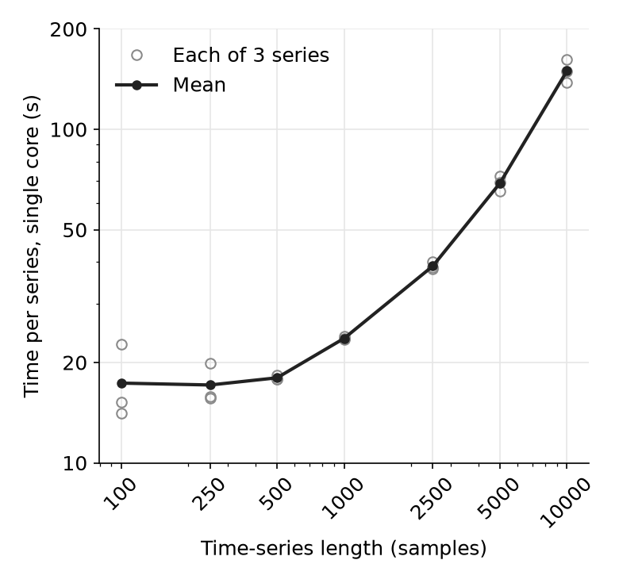

# Performing calculations

Once an _hctsa_ dataset has been initialized (specifying details of a time-series dataset and operations to include using `TS_Init`), all results entries in the resulting `HCTSA.mat` are set to `NaN`, corresponding to results that are as yet uncomputed.

Calculations are performed using the function `TS_Compute`, which stores results back into the matrices in `HCTSA.mat`. This function can be run without inputs to compute all missing values in the default hctsa file, `HCTSA.mat`:

```
    % Compute all missing values in HCTSA.mat:
    TS_Compute();
```

`TS_Compute` evaluates the operations whose entry in `TS_Quality` is `NaN` (i.e., computations that have not been run previously).
Results are stored back in the matrices of `HCTSA.mat`: `TS_DataMat` (output of each operation on each time series), `TS_CalcTime` (calculation time for each operation on each time series), and `TS_Quality` (labels indicating errors or special-valued outputs).
Errors and special-valued outputs (`NaN`, `Inf`, `-Inf`, complex or empty outputs) are recorded with a nonzero [quality label](../setup/hctsa\_structure.md) in `TS_Quality` and stored as `NaN` in `TS_DataMat`, so a `NaN` in `TS_DataMat` does not by itself mean that a value has not yet been computed.
By default, results are written to the file once, at the end of the calculation.

## Inputs to `TS_Compute`

The full set of inputs is:

```
TS_Compute(parallelHow,ts_id_range,op_id_range,computeWhat,customFile,howVocal,beVerbose,autosaveEvery)
```

All inputs are optional.
To set a later input while keeping the default of an earlier one, pass `[]` for the earlier one (except `howVocal`, which must be given as one of its options).

| Input | Default | Description |
| --- | --- | --- |
| `parallelHow` | `'none'` | How to use Matlab's Parallel Computing Toolbox: `'none'`, `'operations'` or `'series'` (see below). |
| `ts_id_range` | `[]` (all) | IDs of the time series to compute. |
| `op_id_range` | `[]` (all) | IDs of the operations to compute. |
| `computeWhat` | `'missing'` | Which entries to compute: `'missing'`, `'error'` or `'bad'` (see below). |
| `customFile` | `'raw'` (`HCTSA.mat`) | The _hctsa_ `.mat` file to read from and write results back to. |
| `howVocal` | `'full'` | How much information to print to screen: `'full'`, `'minimal'` or `'fast'` (see below). |
| `beVerbose` | `false` | Whether to show text output (`fprintf`/warning messages) generated inside individual operations. |
| `autosaveEvery` | `Inf` (off) | How often (in seconds) to save partial progress to file during a long run. |

### (1) Parallel computation

The first input, `parallelHow`, sets how computation is distributed across cores using Matlab's Parallel Computing Toolbox:

* `'none'` (default): no parallelization.
* `'operations'`: parallelizes over master operations _within_ each time series (looping over time series serially). This is best for a dataset of a few long time series.
* `'series'`: parallelizes over time series, with each worker computing whole feature vectors (operations run serially on each worker). This gives a near-linear speedup and is best for datasets of many short time series. In this mode, any errors from individual master operations are reported to screen as each block of time series completes.

For backward compatibility, a logical first input also works: `false` is equivalent to `'none'` and `true` to `'operations'`.

```
    % Compute all missing values in HCTSA.mat, parallelizing over time series:
    TS_Compute('series');
    % Compute all missing values in HCTSA.mat, parallelizing over operations:
    TS_Compute('operations');
```

If no parallel pool is open, `TS_Compute` starts one.
Workers of a local pool inherit the client's path and toolbox licenses; a pool on a remote cluster must be set up (path and licenses) before calling `TS_Compute`.
If a pool cannot be started, the computation runs serially.

### (2) A subset of time series or operations

Computing across a custom range of time-series IDs (`ts_id`) and operation IDs (`op_id`) can be achieved by setting the second and third inputs:

```
    % Compute missing values in HCTSA.mat for ts_ids from 1:10 and op_ids from 1:1000
    TS_Compute('none',1:10,1:1000);
```

### (3) Which values to compute

The fourth input, `computeWhat`, specifies which entries are computed:

```
    % Compute all values that have never been computed before (default)
    TS_Compute('none',[],[],'missing');
    % Also recompute values that previously returned a fatal error (quality label 1):
    TS_Compute('none',[],[],'error');
    % Also recompute any value that was not previously a good value (any quality label > 0,
    % i.e., errors and NaN, Inf, -Inf, complex, empty or link-error outputs):
    TS_Compute('none',[],[],'bad');
```

### (4) A custom file

Specifying a custom `.mat` file to operate on (the default, `'raw'`, refers to `HCTSA.mat`; `[]` or `''` also selects the default):

```
    % Compute all missing values in my_HCTSA_file.mat:
    TS_Compute('none',[],[],'missing','my_HCTSA_file.mat');
```

### (5) Screen output

By default (`howVocal = 'full'`), information about every operation evaluated is displayed to screen (which can be overwhelming but is useful for error checking).
The amount of output can be reduced with the sixth input, `howVocal`:

* `'full'` (default): each piece of master-operation code as it is evaluated, a summary for each time series, and an estimate of the time remaining.
* `'minimal'`: for each time series, a progress bar across its operations and a short summary (the numbers of real-valued outputs, errors and special-valued outputs).
* `'fast'`: just a progress bar across time series.

If `howVocal` is not given and fewer than 30 operations are being computed (e.g., for _catch22_), `'fast'` is used.
Text printed inside individual operations is suppressed unless the seventh input, `beVerbose`, is set to `true`.

```
    % Compute all missing values in HCTSA.mat, showing just a progress bar:
    TS_Compute('none',[],[],'missing','','fast');
```

### (6) Saving progress during long runs

By default, results are saved once, at the end of the calculation, so progress is lost if the job is killed before it finishes.
The eighth input, `autosaveEvery`, writes partial results to the file during the run, every `autosaveEvery` seconds (at most).
Re-running the same call then resumes from the saved progress, since only the missing entries are computed.
Rewriting large files is not free, so the interval is lengthened automatically (to at least 15 times the duration of the most recent save) to keep the saving overhead small.

```
    % Compute all missing values in HCTSA.mat in parallel over time series,
    % saving progress at most every 30 minutes:
    TS_Compute('series',[],[],'missing','HCTSA.mat','fast',false,1800);
```

## Computation approaches for full datasets

Computing features for full time-series datasets can be time consuming, especially for large datasets of long time series.
An appropriate strategy therefore depends on the time-series length, the number of time series in the dataset, and the computational resources available.
When multiple cores are available, using a parallel setting is recommended: `TS_Compute('series')` for many short time series, or `TS_Compute('operations')` for a few long ones.

### Computation time scaling

The first thing to think about is how the time taken to compute the default feature set (6392 features from 927 master operations in v3.0.0) scales with the length of time series in your dataset (see plot below).
The figure compares results using a single core (e.g., `TS_Compute('none')`) to results using a 16-core machine, with parallelization over operations enabled (e.g., `TS_Compute('operations')`).
Note that this plot was made with an earlier, larger version of the feature set (7469 features), before the `'series'` mode existed; timings for v3.0.0 will differ.
As a guide, the v3.0.0 release notes quote about 31 s per time series on a single core for the full feature set (on a corpus of 1000 synthetic time series).



Times may vary across individual machines, but the above plot can be used to estimate the computation time per time series, and thus help decide on an appropriate computation strategy for a given dataset.

Note that if computation times are too long for the computational resources at hand, one can always choose a reduced set of features, rather than the full default set, to get a preliminary understanding of the dataset -- e.g., the `catch22` feature set (`TS_Init(...,'catch22')`) is a much smaller, canonical subset designed for this purpose.

### On a single machine

If only a single machine is available for computation, there are a couple of options:

1. For small datasets, when it is feasible to run all computations in a single go, it is easiest to run computations within Matlab in a single call of `TS_Compute`.
2. For larger datasets that may run for a long time on a single machine, set `autosaveEvery` (see above) so that progress is saved periodically, and re-run the same call to resume if the job is interrupted.
   Alternatively, use something like the provided `sample_runscript_matlab(doParallelize,saveIncrement,fileName)` function (in the `Calculation` directory), where `TS_Compute` commands are run in a loop over blocks of time series (`saveIncrement` time series at a time, 5 by default), saving the results to file (e.g., `HCTSA.mat`) after each block, eventually covering the full dataset iteratively.

### On a distributed compute cluster using Matlab

With a distributed computing setup, a local Matlab file (`HCTSA.mat`) can be split into smaller pieces using `TS_Subset`, which outputs a new data file for a particular subset of your data.
For example, `TS_Subset('raw',1:100)` will generate a new file, `HCTSA_subset.mat`, that contains just time series with IDs from 1 to 100; a custom output filename can be given as the fifth input, e.g., `TS_Subset('raw',1:100,[],true,'HCTSA_1.mat')`.
Computing features for time series in each such subset can then be run on a distributed computing setup, for example, with a different compute node computing a different subset (by queuing batch jobs that each run `TS_Compute` on a given subset file, e.g., `TS_Compute('series',[],[],'missing','HCTSA_1.mat','fast',false,1800)`).
After all subsets have been computed, the results are recombined into a single `HCTSA.mat` file using `TS_Combine`, which can combine many files in a single pass, e.g., `TS_Combine({'HCTSA_1.mat','HCTSA_2.mat','HCTSA_3.mat'},'HCTSA.mat',true)`.
If the output file (here the original `HCTSA.mat`) already exists, the result is saved to `HCTSA_combined.mat` instead, unless the fourth input (`forceWrite`) is `true` (see [Working with hctsa files](working_with_hctsa_files.md)).
Example scripts for running distributed _hctsa_ computations on a cluster (using pbs or slurm schedulers), written for an earlier version of _hctsa_, are [here](https://github.com/benfulcher/distributed\_hctsa).
